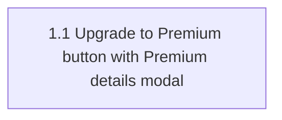

# aire State Tracking

## Project Information
- **Project**: context-test (StreamPlex) — Upgrade to Premium button (frontend only)
- **Start Date**: 2026-11-13T08:24:52Z
- **AIRE Version**: 1.0

## Tracker
- Type: LOCAL
- Parent Epic: none
- Epic URL: —
- Project Key / Repo / Org: —

## Workspace State
- **Type**: Brownfield
- **Code root**: src/ (src/frontend — React 19 + Vite + react-router; src/backend — Python main.py)
- **Base branch**: main (in sync with origin/main at c21cbfd; src/ untracked)

## Extension Configuration
- Security Baseline: Enabled = Yes (mandatory)
- Playwright Test Automation: Enabled = Yes (mandatory)
- UI/UX Mockups: Enabled = No (Requirements Analysis)
- Resiliency Baseline: Enabled = No (Requirements Analysis)
- Property-Based Testing: Enabled = No (Requirements Analysis)

## Stage Progress
- [x] Workspace Detection
- [x] Reverse Engineering
- [x] Requirements Analysis
- [x] User Stories
- [ ] Dependency Graph
- [ ] Workflow Planning

## Branching
- Base Branch: main
- Epic Branch: epic/upgrade-to-premium-button
- Epic PR: (not raised — raised manually at cycle end via pr-generator)

## Existing-System Context
- Source: local-generation (Atlas unavailable — user approved)
- Note: Existing-system context derived locally; Atlas was not consulted.

## Atlas Artifact Sync
- Enabled: No
- Source: user opt-out

## Context Project
- **Existing Knowledge**: No
- **Existing Knowledge Path(s)**: —
- **New References**: No
- **New Reference Path(s)**: —
- **Figma Design(s)**: —

## Design References
- (none registered)

## Reverse Engineering Status
- [x] Reverse Engineering - Completed on 2026-11-13T08:30:37Z (local generation, approved)
- **Artifacts Location**: spec/plans/

## Story Planning
- team_size: 2
- story_creation_mode: all-at-once
- target_story_count: 1

## Story Tracker

| Story | Title   | Requires | Tracker ID | Status         | PR         | Merged | Start      | End        | Recorded           |
|-------|---------|----------|------------|----------------|------------|--------|------------|------------|--------------------|
| 1.1   | Upgrade to Premium button with Premium details modal | none | LOCAL | Ready for Development | — | — | | | 2026-11-13T08:39:33Z |

## Dependency Graph

- Ready now: 1.1 (no prerequisites)
- Blocked: none
- Inferred edges: none (single story)
- Parallelism: 1 startable story vs team_size 2 — below target by design (user requested a single story)
