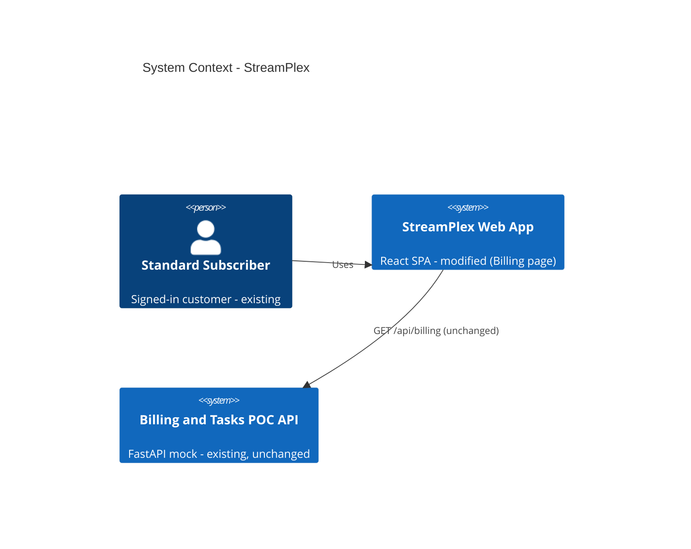
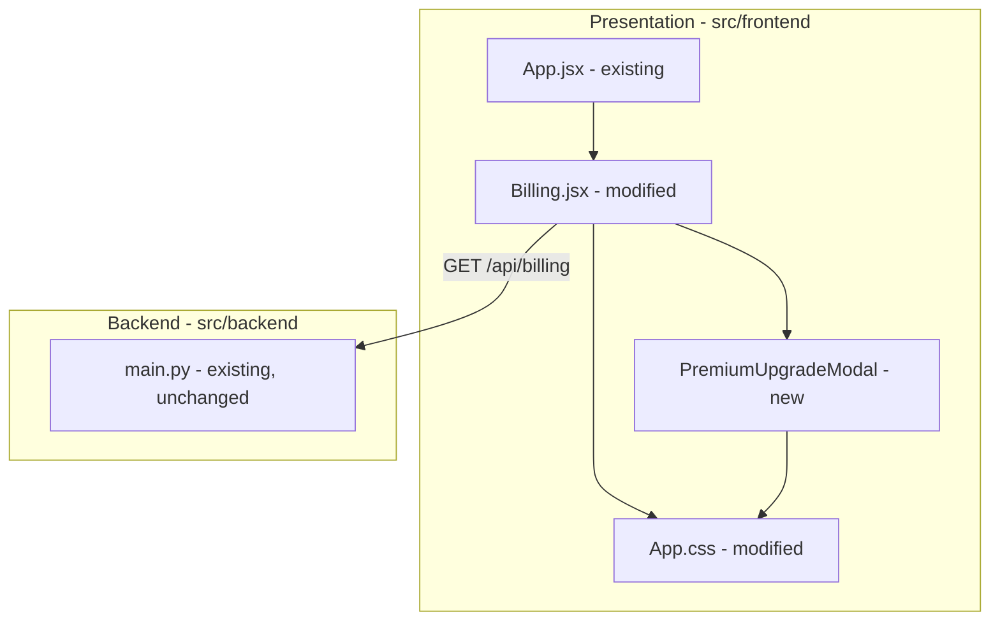

# Architecture — StreamPlex (Upgrade to Premium button)

> **Version**: 1.1.0 · **Generated**: 2026-11-13T08:44:23Z · **AIRE**: v1.0
> **Derived from**: spec/plans/atlas-deep-dive.md, spec/plans/code-structure.md, spec/plans/api-documentation.md, spec/plans/requirements.md, spec/plans/stories.md, spec/plans/executions.md
> **Existing-system baseline**: none from Atlas — Existing-system context derived locally; Atlas was not consulted.
> **Skipped design stages**: Application Design, Functional Design, NFR Requirements, NFR Design, Infrastructure Design (all skipped in spec/plans/executions.md). Where a section would have drawn on them, it says so and states the default.

## 1. System Context
StreamPlex is a POC streaming account portal. A subscriber uses the React SPA in a browser; the SPA calls the FastAPI mock API over `/api`. This cycle modifies only the SPA's Plan and Billing page. No new external systems.

## 2. Component Inventory
| Component | Responsibility | Status | Source |
|---|---|---|---|
| App.jsx (routes, Layout, ProtectedRoute) | Routing and shell | existing (unchanged) | spec/plans/atlas-deep-dive.md |
| AuthContext.jsx | Auth state and API calls | existing (unchanged) | spec/plans/atlas-deep-dive.md |
| Billing.jsx | Plan and Billing page; hosts the Upgrade to Premium button and modal state | existing (modified) | spec/plans/stories.md Story 1.1 |
| Premium upgrade modal (in `src/frontend/src/components/`) | Static Premium details dialog with Continue / Cancel / Close | new | spec/plans/requirements.md REQ-F-03..05, REQ-NF-03 |
| App.css | Styles for the button placement, modal and message | existing (modified) | spec/plans/requirements.md REQ-NF-02 |
| src/backend/main.py | Mock API | existing (unchanged) | spec/plans/api-documentation.md |

## 3. Layering and Boundaries
- The modal is a presentational component: it receives `open`, `onContinue` and `onClose` props and renders static content. It never calls `fetch`, never uses `useAuth`, and holds no plan data from the API.
- `Billing.jsx` owns the UI state (`modal open`, `coming-soon message shown`) with `useState`. No new React context, no router change.
- Nothing under `src/backend/` is modified.

## 4. Data Architecture
No store, schema or model is introduced or changed (Functional Design skipped — none needed). Premium plan details are a static constant in the frontend: `$30/month`, `Ultra HD (4K)`, `Watch on 4 devices at once`, `Download on 6 devices`, `Ad-free streaming`, `Spatial audio`. No ER diagram — no store changed.

## 5. API and Integration Contracts
No new or changed contracts. The page continues to consume `GET /api/billing?email=` exactly as today. The upgrade flow makes no request.

## 6. Cross-Cutting Decisions
- **AuthN/AuthZ**: unchanged — `/billing` stays behind `ProtectedRoute`.
- **Error handling**: no new failure paths (no I/O). The button renders only in the active-plan branch, so a missing/failed billing load shows no button (fail-safe default).
- **Accessibility**: modal uses `role="dialog"`, `aria-modal="true"`, `aria-labelledby` pointing at its "Upgrade to Premium" heading; focus moves into the dialog on open and returns to the trigger button on close; Escape closes; Close control has an accessible label "Close".
- **Logging, config, secrets, observability, resilience**: N/A — no new runtime behaviour beyond local UI state (NFR stages skipped; defaults apply).

## 7. Non-Functional Targets
| Concern | Target | Source | How it is verified |
|---|---|---|---|
| Network | 0 new requests from the upgrade flow | REQ-NF-01 | unit test spies on fetch; Playwright |
| Accessibility | dialog semantics, focus in/out, Escape | REQ-NF-03 | unit tests (Testing Library roles) |
| Unit coverage | at or above `unitTestCoverageMin` on changed files | REQ-NF-04, tests/.evals/config.json | vitest coverage |

## 8. Infrastructure and Deployment
Unchanged (Infrastructure Design skipped — none needed). Vite dev server / production build served by FastAPI static mount, as before.

## 9. Delta from the Existing System
| Area | Before | After | Reason |
|---|---|---|---|
| Billing page, active plan view | Plan badge, price card, renew card, features, perks | Same, plus an "Upgrade to Premium" button next to plan/price, a Premium details modal and a coming-soon message | REQ-F-01..05 |
| Components | No modal component | New presentational `PremiumUpgradeModal` | REQ-F-03, REQ-NF-03 |
| Backend | — | No change | REQ-NF-01 |

## 10. Verifiable Constraints

### ARCH-01 — Frontend only, no new network calls
- **Constraint**: The Upgrade to Premium change adds no backend code and no network request.
- **Verifiable as**: The diff contains no change under `src/backend/`, and no added `fetch`, `XMLHttpRequest`, axios or other request call in the button/modal code path. Score 0 on any such change.
- **Weight**: 0.30
- **Source**: spec/plans/requirements.md (REQ-NF-01)

### ARCH-02 — Presentational modal component
- **Constraint**: The Premium modal is a presentational component driven by props, with its state owned by Billing.jsx.
- **Verifiable as**: The modal component does not call `useAuth`, `fetch` or router hooks, and does not hold the open/closed state itself; Billing.jsx owns that state. Score 0 if the modal reads auth/API data or manages its own visibility.
- **Weight**: 0.25
- **Source**: spec/plans/stories.md (Story 1.1), this document Section 3

### ARCH-03 — Active-plan-only rendering
- **Constraint**: The Upgrade to Premium button renders only in Billing.jsx's active-plan branch.
- **Verifiable as**: The button element appears only inside the branch rendered when billing data exists and `has_plan !== false`, never in the loading or "No active plan" branches. Score 0 otherwise.
- **Weight**: 0.20
- **Source**: spec/plans/requirements.md (REQ-F-02)

### ARCH-04 — Accessible dialog semantics
- **Constraint**: The modal exposes dialog semantics and manages focus and Escape.
- **Verifiable as**: The modal root has `role="dialog"`, `aria-modal="true"` and an accessible name from its heading; code moves focus into it on open, restores focus to the trigger on close, and handles Escape. Score 0 if any of these is missing.
- **Weight**: 0.15
- **Source**: spec/plans/requirements.md (REQ-NF-03)

### ARCH-05 — Reuse existing styling, no new runtime dependencies
- **Constraint**: The button reuses the existing `.btn` class and no new runtime npm dependency is added.
- **Verifiable as**: The button uses the `btn` class from App.css, and the `dependencies` block of `src/frontend/package.json` is unchanged (test tooling in `devDependencies`, such as the framework-mandated `@playwright/test`, is allowed). Score 0 if a runtime package is added or the button bypasses `.btn` for a different primary style.
- **Weight**: 0.10
- **Source**: spec/plans/requirements.md (REQ-NF-02, REQ-NF-05)

## 11. Explicitly Out of Scope
- Any real plan change, payment, checkout or persistence of Premium.
- Backend Premium plan data or an upgrade endpoint.
- Top navigation bar placement; a separate /upgrade route.
- A generic modal library or design-system dependency.

## Change Log
- 1.1.0 (dev-implement Story 1.1, before code): ARCH-05 narrowed from "no dependency changes" to "no new runtime dependency" — the framework-mandated Playwright readiness step adds `@playwright/test` as a devDependency, which the 1.0.0 wording would have forbidden. Weights unchanged.
