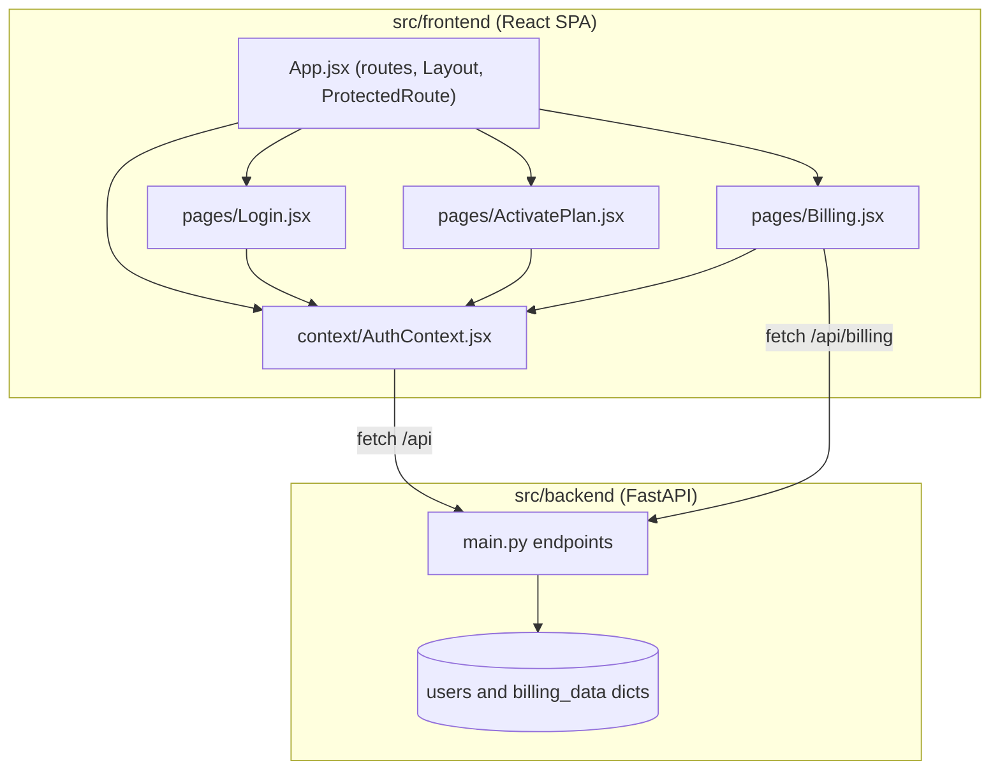
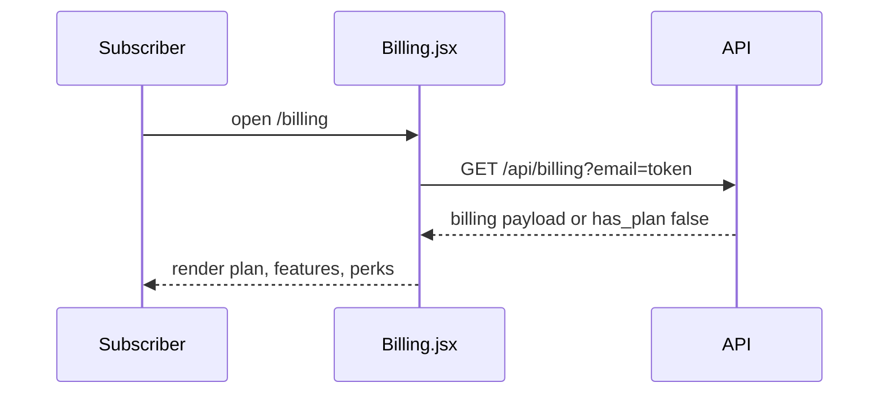

# System Architecture

> Existing-system context derived locally; Atlas was not consulted. Source: local-generation (Atlas unavailable — user approved). Analyzed at commit b774b82, 2026-11-13T08:28:49Z.

## System Overview
Two-module monorepo under `src/`: a React 19 single-page app (`src/frontend`, Vite dev server with `/api` proxied to `http://localhost:8000`) and a FastAPI mock API (`src/backend/main.py`) holding all data in process memory. In production the API serves the built frontend from `src/frontend/dist` when present.

The `spec/context-project/existing-knowledge/` folder is human-curated AIRE context input, not application source.

## Architecture Diagram

## Component Descriptions
### App.jsx
- **Purpose**: Router and shell. Routes: `/` and `/login` (Login), `/activate-plan` (protected), `/billing` (protected, wrapped in Layout with top bar).
- **Responsibilities**: routing, auth guard, top bar with Billing link, user pill and Logout.
- **Dependencies**: react-router-dom, AuthContext
- **Type**: Application

### context/AuthContext.jsx
- **Purpose**: Holds `user` / `token` (token = email, persisted in localStorage); exposes `login`, `register`, `activatePlan`, `logout`.
- **Dependencies**: backend `/api/auth/*`, `/api/users/me`, `/api/billing/activate`
- **Type**: Application

### pages/Billing.jsx
- **Purpose**: Plan and Billing page. Two render states: `has_plan === false` (No active plan + "Activate Standard plan" button) and active plan (Standard badge, price card, renew card, features grid, Plan perks card).
- **Dependencies**: AuthContext, `GET /api/billing`
- **Type**: Application — the page where an Upgrade to Premium button belongs.

### pages/ActivatePlan.jsx and pages/Login.jsx
- **Purpose**: Post-sign-up Standard activation prompt; sign-in / sign-up form.
- **Type**: Application

### src/backend/main.py
- **Purpose**: Mock REST API, in-memory store, CORS `*`.
- **Type**: Application

## Data Flow

## Integration Points
- **External APIs**: none
- **Databases**: none (in-memory dicts)
- **Third-party Services**: none (no payment provider)

## Infrastructure Components
- **CDK Stacks**: none
- **Deployment Model**: local dev (Vite dev server, uvicorn on 8000); optional FastAPI static serving of the built SPA
- **Networking**: not applicable
