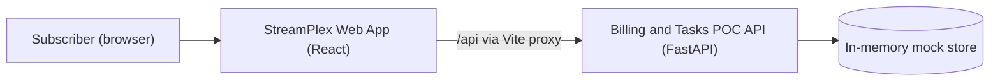

# Business Overview

> Existing-system context derived locally; Atlas was not consulted. Source: local-generation (Atlas unavailable — user approved). Analyzed at commit b774b82, 2026-11-13T08:28:49Z.

## Business Context Diagram

## Business Description
- **Business Description**: StreamPlex is a proof-of-concept video-streaming account portal. A subscriber signs in or signs up, optionally activates the Standard plan ($20/month), and views their Plan and Billing page with plan features and perks. Only one paid plan (Standard) exists today; there is no Premium tier anywhere in the code.
- **Business Transactions**:
  - **BT-1 Sign in** — email + password; on success the user lands on /billing.
  - **BT-2 Sign up** — name + email + password; on success the user lands on /activate-plan.
  - **BT-3 Activate Standard plan** — from /activate-plan (Yes) or from the Billing "No active plan" state.
  - **BT-4 View Plan and Billing** — current plan badge, price, renewal date, features, perks.
  - **BT-5 Log out** — clears token, returns to /login.
- **Business Dictionary**:
  - **Plan** — subscription tier; only "Standard" exists.
  - **Standard** — $20/month tier: Full HD, 2 screens, 2 download devices, ad-free, spatial audio.
  - **Perks** — plan extras shown in the "Plan perks" card.
  - **Renew at** — next renewal date of the active plan.

## Component Level Business Descriptions
### src/frontend (StreamPlex Web App)
- **Purpose**: Subscriber-facing UI for authentication, plan activation and billing view.
- **Responsibilities**: Login/sign-up forms, protected routing, plan activation prompt, Plan and Billing page.

### src/backend (Billing and Tasks POC API)
- **Purpose**: Mock API with in-memory users and billing data.
- **Responsibilities**: Login, register, current user, billing read, Standard plan activation.
