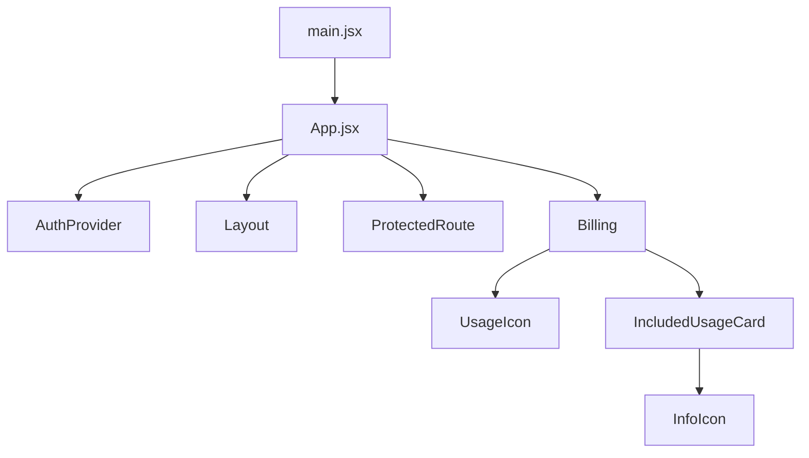

# Code Structure

> Existing-system context derived locally; Atlas was not consulted. Source: local-generation (Atlas unavailable — user approved). Analyzed at commit b774b82, 2026-11-13T08:28:49Z.

## Build System
- **Type**: npm (frontend, Vite 8), pip (backend)
- **Configuration**: `src/frontend/package.json` (scripts dev/build/lint/preview), `vite.config.js` (`/api` proxy), `vitest.config.js` (jsdom; tests read from `tests/unit/frontend/**/*.test.jsx`; coverage scoped to AuthContext.jsx, Billing.jsx, ActivatePlan.jsx), `.oxlintrc.json`; `src/backend/requirements.txt`, `requirements-dev.txt`

## Key Classes/Modules

### Existing Files Inventory
- `src/frontend/src/main.jsx` - React root mount
- `src/frontend/src/App.jsx` - routes, Layout top bar, ProtectedRoute
- `src/frontend/src/App.css` - all component styles (579 lines; `.btn` primary teal #0f766e, `.standard-badge`, `.badge`, `.plan-card`, `.renew-card`)
- `src/frontend/src/index.css` - global base styles
- `src/frontend/src/context/AuthContext.jsx` - auth state and API calls
- `src/frontend/src/pages/Login.jsx` - sign in / sign up
- `src/frontend/src/pages/ActivatePlan.jsx` - Standard activation prompt
- `src/frontend/src/pages/Billing.jsx` - Plan and Billing page (modification candidate)
- `src/backend/main.py` - FastAPI mock API

## Design Patterns
### React Context for auth
- **Location**: AuthContext.jsx
- **Purpose**: share token/user and auth actions
- **Implementation**: `createContext` + `useAuth()` hook
### Protected route wrapper
- **Location**: App.jsx `ProtectedRoute`
- **Purpose**: redirect to /login when no token
- **Implementation**: renders children or `<Navigate to="/login" replace />`
### Plain CSS classes
- **Location**: App.css
- **Purpose**: styling without a CSS framework
- **Implementation**: global class names, occasional inline style objects

## Critical Dependencies
### react / react-dom
- **Version**: ^19.2.8
- **Usage**: all UI
- **Purpose**: component rendering
### react-router-dom
- **Version**: ^7.18.2
- **Usage**: routing, `NavLink`, `useNavigate`
- **Purpose**: SPA navigation
### fastapi
- **Version**: unpinned
- **Usage**: backend API
- **Purpose**: REST endpoints
