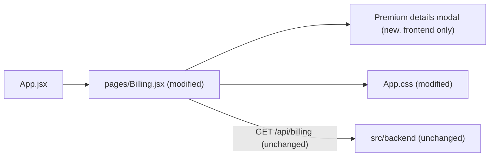
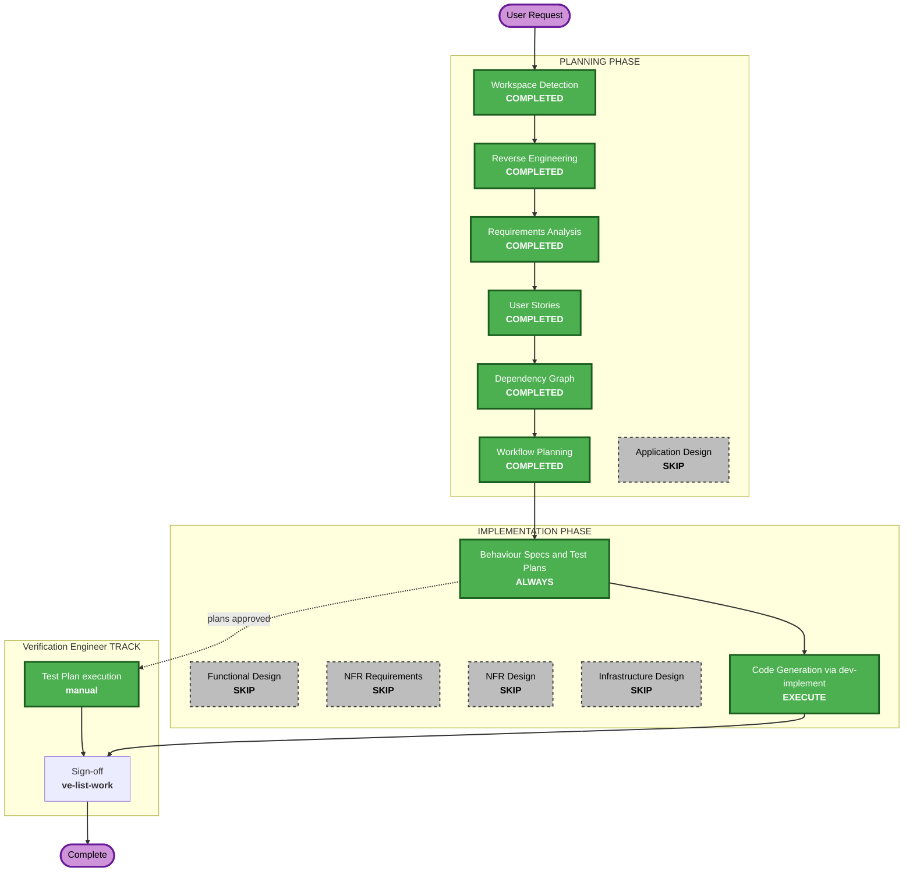

# Execution Plan

> Existing-system context derived locally; Atlas was not consulted.

## Detailed Analysis Summary

### Transformation Scope (Brownfield Only)
- **Transformation Type**: Single component
- **Primary Changes**: Add an "Upgrade to Premium" button and a static Premium details modal to the Plan and Billing page
- **Related Components**: `src/frontend/src/pages/Billing.jsx`, `src/frontend/src/App.css` (plus a small new modal component if useful). `src/backend/` untouched.

### Change Impact Assessment
- **User-facing changes**: Yes — new button and modal on `/billing` (active Standard plan view only)
- **Structural changes**: No — no routes, context or architecture changes
- **Data model changes**: No — Premium values are static frontend placeholders
- **API changes**: No — no new or changed endpoints, no new network calls
- **NFR impact**: Yes (minor) — modal accessibility (dialog semantics, focus, Escape)

### Component Relationships (Brownfield Only)

### Risk Assessment
- **Risk Level**: Low
- **Rollback Complexity**: Easy (revert one story PR)
- **Testing Complexity**: Simple

## Workflow Visualization

## Phases to Execute

### PLANNING PHASE
- [x] Workspace Detection (COMPLETED)
- [x] Reverse Engineering (COMPLETED — local generation)
- [x] Requirements Analysis (COMPLETED)
- [x] User Stories (COMPLETED)
- [x] Dependency Graph (COMPLETED)
- [x] Execution Plan (COMPLETED)
- [ ] Application Design - SKIP
  - **Rationale**: one presentational modal inside an existing page; no new services, component contracts or business rules needing design

### IMPLEMENTATION PHASE
- [ ] Functional Design - SKIP
  - **Rationale**: no data models or business logic; behaviour fully specified by Story 1.1 ACs
- [ ] NFR Requirements - SKIP
  - **Rationale**: stack fixed (React/Vite); the only NFRs (accessibility, no network, security) are already captured as REQ-NF-01..05
- [ ] NFR Design - SKIP
  - **Rationale**: NFR Requirements skipped
- [ ] Infrastructure Design - SKIP
  - **Rationale**: no infrastructure or deployment change
- [ ] Behaviour Specs and Test Plans - EXECUTE (ALWAYS, at the STOP CHECKPOINT, ONE approval)
  - **Rationale**: Story 1.1 `.feature` contract and manual test plan written and approved before code
- [ ] Code Generation - EXECUTE (ALWAYS, via `dev-implement`)
  - **Rationale**: implement Story 1.1 with unit tests

### Verification Engineer TRACK (parallel — ve-initiated, NOT planned or executed by this workflow)
- Test Plan — authored at the STOP CHECKPOINT; the Verification Engineer executes it once the story PR merges
- Verification Engineer Sign-off — `ve-list-work` on the epic branch

## Package Change Sequence (Brownfield Only)
1. `src/frontend` only. `src/backend` — no change.

## Estimated Timeline
- **Total Phases**: 9 executed (6 planning complete + STOP CHECKPOINT + code generation + Verification Engineer track), 5 skipped
- **Estimated Duration**: short — single small UI story

## Success Criteria
- **Primary Goal**: Standard subscribers see an Upgrade to Premium button that opens a Premium details modal, with no backend changes
- **Key Deliverables**: modified `Billing.jsx` and `App.css`, unit tests in `tests/unit/frontend/`, `.feature` contract, manual test plan, Playwright UI test
- **Quality Gates**: unit tests pass at coverage threshold, lint clean (no new errors), code review clean, Security Baseline compliant
- **Integration Testing**: Billing page still loads billing data and renders unchanged elsewhere
- **Operational Readiness**: N/A (no runtime/infra change)
